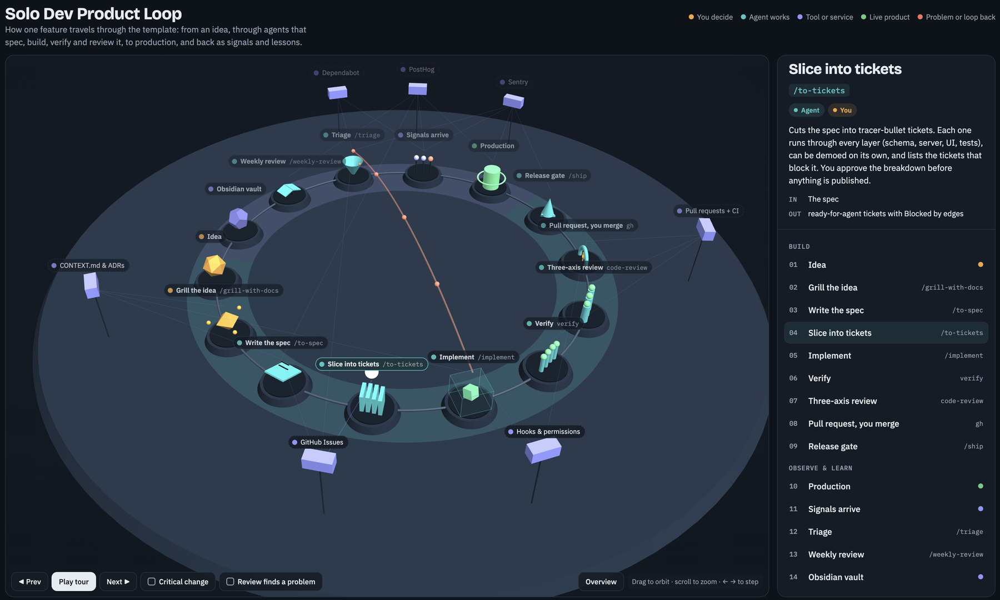

# Solo dev product template

[](https://github.com/gedewon/solo-dev-product-template/actions/workflows/ci.yml)
[](LICENSE)

A Next.js starter for one developer working with AI agents. Claude Code turns an idea into a spec, the spec into tickets, and each ticket into a tested, reviewed pull request. You make the product decisions and merge. After release, errors, product metrics and dependency updates come back as new tickets and a weekly review.

[](https://gedewon.github.io/solo-dev-product-template/)

**[Open the live 3D map](https://gedewon.github.io/solo-dev-product-template/)** to follow one feature around the loop. Click any step to see who acts, what goes in and out, and what is enforced. The same loop is drawn as a diagram at the top of [`WORKFLOW.md`](WORKFLOW.md#the-loop).

## What you get

- Eighteen Claude Code skills that cover the whole loop: grilling an idea, writing the spec, slicing tickets, building test-first, verifying, a three-axis review, release checks, error triage and a weekly review.
- Two reviewer agents, one for security and one for the database, that join the review when a change needs them.
- Guardrails that agents can't talk their way around. A hook blocks edits to `.env` files, the lockfile, `.git/` and committed migrations, and the settings deny force pushes, hard resets and merging pull requests.
- A minimal Next.js 16 app with design tokens, Vitest and CI, so the first `pnpm check:full` passes on day one.
- Sentry, PostHog, Dependabot and Obsidian wired into the loop. Specs name the metric a feature should move, and the weekly review checks whether it did.

## Requirements

- Node 22 or newer, and pnpm through `corepack enable`
- [Claude Code](https://code.claude.com/docs)
- The [GitHub CLI](https://cli.github.com/), signed in, so agents can read and write issues and open pull requests
- Optional: Sentry and PostHog accounts, and an Obsidian vault

## Start a new project

1. Click **Use this template** on GitHub to create your repo, then clone it.
2. Run the setup script:

   ```bash
   corepack enable
   scripts/setup.sh my-app
   ```

   The script renames the package, creates `.env.local` from `.env.example`, installs dependencies, creates the GitHub labels the agents use, and runs `pnpm check:full`.
3. Fill in the `TODO(setup)` sections in `AGENTS.md`. The skills read them: what the product is, its critical areas with their invariants, and the user journeys that must never break.
4. Replace this README with your product's own, and review `LICENSE`, `CONTRIBUTING.md`, `CODE_OF_CONDUCT.md` and `SECURITY.md`, which describe the template.
5. Commit everything, including `pnpm-lock.yaml`, and push.
6. In Claude Code, run `/setup-observability` to add Sentry and PostHog. Merge its pull request, then run `/mcp` to sign in to both.
7. Run `/grill-with-docs` with your first feature idea.

## How work moves

[`WORKFLOW.md`](WORKFLOW.md) is the full guide. The short version:

| Step | Command | Who |
|---|---|---|
| Shape the idea through questions | `/grill-with-docs` | you and Claude |
| Write the spec | `/to-spec` | Claude |
| Slice it into tickets | `/to-tickets` | Claude, you approve |
| Build one ticket and open a PR | `/implement #42` | Claude |
| Merge | GitHub | you |
| Check the release | `/ship` | Claude |
| Turn errors and dependency updates into tickets | `/triage` | Claude, daily |
| Review the week and pick the next bet | `/weekly-review` | Claude, then you |

## What's inside

```
AGENTS.md                      instructions every coding agent reads
CLAUDE.md                      imports AGENTS.md and lists the skills
WORKFLOW.md                    the guide to the loop, with a diagram
CONTRIBUTING.md                how to propose changes to the template
.claude/
  skills/                      the workflow skills
  agents/                      security-reviewer, database-reviewer
  rules/                       git and architecture load in every session;
                               typescript, nextjs, security, supabase, testing
                               and observability load only for matching files
  hooks/protect-files.mjs      blocks edits to .env files, the lockfile, .git/
                               and committed migrations
  settings.json                allowed and denied commands, hook registration
  kit-manifest.txt             the files the kit owns
.mcp.json                      Sentry and PostHog MCP servers
docs/
  adr/                         decisions that are hard to reverse
  agents/issue-tracker.md      how agents use GitHub Issues, and the labels
  analytics/tracking-plan.md   every analytics event and feature flag
  workflow/loop.html           the 3D map, published to GitHub Pages
scripts/
  setup.sh                     one-time setup for a new project
  sync-kit.sh                  pulls kit updates into a project
  check-kit.mjs                checks that skills, docs and manifest agree
.github/                       CI, Dependabot, Pages, PR and issue templates
app/, lib/                     the Next.js app
```

## Design choices

- **Short, scoped instructions.** Only `AGENTS.md`, `CLAUDE.md` and two rules load in every session, about 8 KB. Other rules load when Claude touches matching files, and skills load when they run. Each checklist lives in one file: security in the `security-reviewer` agent, database in `database-reviewer`, verification in `verify`.
- **Risk decides how much process a change gets.** `/implement` sorts each change into Simple, Normal, Cross-cutting or Critical. Critical work writes its invariants down before any code, and both specialist reviewers always run.
- **Three separate review reports.** Standards, Spec and Risk run in parallel and report side by side. A clean change that matches its spec but lets one user edit another's data still fails.
- **Enforcement where it matters.** The hook and the denied commands always apply. Instructions cover everything else. `WORKFLOW.md` lists which is which.
- **Agents open pull requests and you merge them.** `gh pr merge` is a denied command.
- **The kit lives in each repo.** Cloud sessions on claude.ai don't load plugins, but they do load a repo's `.claude/` folder. See [ADR 0001](docs/adr/0001-vendor-the-agent-kit-in-each-repo.md).
- **Product integrations wait until a project needs them.** Supabase, payments and email aren't pre-wired. Add them in the first project that needs them, then bring the working setup back to this template.

## Keep projects up to date

The kit is every file listed in `.claude/kit-manifest.txt`. Improve it in this repo, then pull it into each project:

```bash
scripts/sync-kit.sh --dry-run   # list what would change
scripts/sync-kit.sh             # apply; then review with git diff and commit
```

`replace` files are overwritten on every sync. `seed` files are copied once and then belong to the project. The script records the template commit it synced from in `.claude/kit-version`.

To adopt the kit in an existing repo, copy `scripts/sync-kit.sh` into it and run it with this repo's URL or a local path as the argument. Then delete the repo's older copies of the same workflows, and make sure its `CLAUDE.md` contains the line `@AGENTS.md`.

If you fork this template, change `DEFAULT_KIT_SOURCE` in `scripts/sync-kit.sh` and `KIT_SOURCE` in `scripts/setup.sh` to your fork.

## Contributing

Issues and pull requests are welcome. Read [CONTRIBUTING.md](CONTRIBUTING.md) first; it explains how the kit is organised and how to test a change to a skill. This project follows a [code of conduct](CODE_OF_CONDUCT.md), and security problems go through [SECURITY.md](SECURITY.md), not public issues.

## License

[MIT](LICENSE)
