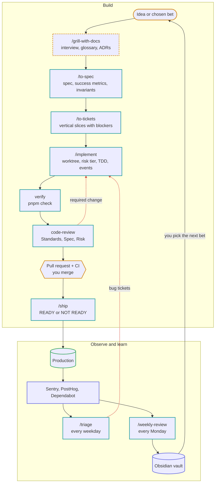

# How work moves through this repo

You describe outcomes and make the product and architecture decisions. Claude plans, builds, tests, reviews and opens pull requests. You merge.

## The loop

Amber is you, teal is an agent, indigo is a tool or service, green is the live product. Red arrows send work back.



To explore the same loop in 3D, open [`docs/workflow/loop.html`](docs/workflow/loop.html) in a browser: download it or clone the repo, then double-click it. A packet tours every step, and a side panel explains who acts, what goes in and out, and what is enforced. The toggles show what changes for a critical change and when review finds a problem.

Every spec says how success will be measured. `/implement` adds the events. `/weekly-review` reads them back a week later and asks whether it worked. That is what turns a build pipeline into a product loop.

## Commands

| You want to | Run | What happens |
|---|---|---|
| Think a feature through | `/grill-with-docs` | Claude interviews you in rounds, one decision branch at a time, with a recommended answer for each question. Domain terms go into `CONTEXT.md` as they settle; hard-to-reverse decisions can become ADRs. |
| Write it down | `/to-spec` | Turns the conversation into a spec issue: problem, solution, user stories, implementation and testing decisions, critical invariants, out of scope. Asks you one thing: which seams to test at. |
| Plan the build | `/to-tickets` | Slices the spec into tickets that each cut through every layer and can be demoed alone, with blocking edges. You approve the breakdown before anything is published. |
| Build | `/implement #42` or `/implement add a logout button` | Works in a separate worktree, triages risk, builds test-first, runs the checks, reviews on three axes, fixes what the review finds, opens a PR. |
| Check a change | `/code-review` | Standards, Spec and Risk reviews in parallel, reported side by side. |
| Focused review | `/security`, `/db-review` | Runs one specialist reviewer on the current diff. |
| Release | `/ship` | Full build, migration and secrets checks, operational basics. Reports READY or NOT READY. Never deploys unless you ask. |
| Find structural problems | `/improve-codebase-architecture` | Finds shallow modules worth deepening, shows them in an HTML report, then grills you on the one you pick. |
| Add error tracking and analytics | `/setup-observability` | Once per project. You run the Sentry and PostHog wizards (they need your browser login); Claude then fixes up privacy, env vars and tests, and opens a PR. |
| Turn problems into tickets | `/triage` | New and regressed Sentry errors become `bug` tickets with stack traces and likely causes. Dependabot PRs get a merge recommendation or a migration ticket. Nothing is merged or fixed. |
| Review the week | `/weekly-review` | What shipped and whether it moved its metric, what broke, dependency and ticket health, lessons, and two or three bets for next week. Written to your Obsidian vault. |

For a tiny change (copy, colour, one obvious line), just ask. Claude still runs `pnpm check`.

## Risk tiers

`/implement` sorts every change into a tier, which decides how much process it gets:

| Tier | Examples | Extra steps |
|---|---|---|
| Simple | copy, styling, docs | none beyond verify and review |
| Normal | a new screen, a filter, a form | a short plan if there's no ticket |
| Cross-cutting | a new table, endpoint, integration or permission | plan; specialists join the review when the diff needs them |
| Critical | anything in the Critical areas of `AGENTS.md` | invariants written first; security and database reviewers always run |

## When Claude stops to ask

It will stop for:

- a plan or a set of invariants it needs you to confirm
- destructive migrations, production data, authentication or payment behaviour, major new dependencies, and architecture that is hard to reverse

Answer these on purpose. They are the decisions that are yours.

It will not stop to ask whether to push or open a PR; that is the agreed default.

## What enforces what

| Mechanism | Strength | Used for |
|---|---|---|
| `.claude/hooks/protect-files.mjs` | Enforced. Blocks the edit. | `.env` files, the lockfile, `.git/`, committed migrations |
| Dependabot + CI | Enforced. Every dependency update is a tested PR. | dependency drift |
| `.claude/settings.json` permissions | Enforced. Denied commands never run. | force push, hard reset, merging PRs, pushing migrations to the linked database |
| CI (`.github/workflows/ci.yml`) | Enforced on every PR | typecheck, lint, tests, build |
| `AGENTS.md`, rules, skills | Instructions. Claude follows them, but nothing forces it. | everything else |

If a rule keeps getting broken, move it up this table.

## The project-independent tools

These four work the same in every project made from this template.

| Tool | Job in the loop | How agents reach it |
|---|---|---|
| **Sentry** | What broke, for whom, since which release | `sentry` server in `.mcp.json`; `/triage`, `/ship`, `/weekly-review` |
| **PostHog** | Did the feature work; feature flags for gradual rollout | `posthog` server in `.mcp.json`; specs name events, `/implement` adds them, `/weekly-review` reads them |
| **Dependabot** | Dependencies stay current without a weekly chore | `.github/dependabot.yml` opens grouped PRs every Monday; `/triage` reviews them; CI tests them; you merge |
| **Obsidian** | Memory across projects: weekly reviews, lessons, decisions you want to keep | `/weekly-review` and `/triage` write Markdown into your vault |

### Connect Sentry and PostHog to Claude

After `/setup-observability`, run `/mcp` in Claude Code and sign in to `sentry` and `posthog`. Do this once per machine. In cloud sessions, the servers load from `.mcp.json` too, but they may ask you to sign in again.

### Obsidian

Your vault stays outside the repo, shared across all projects:

```
<your vault>/
  Projects/<repo name>/Reviews/2026-W43.md    written by /weekly-review and /triage
  Learnings/                                  cross-project lessons
```

Point Claude at it once per machine, in `~/.claude/settings.json` (merge with what's there):

```json
{
  "env": { "OBSIDIAN_VAULT": "/Users/you/Obsidian/Brain" },
  "permissions": { "additionalDirectories": ["/Users/you/Obsidian/Brain"] }
}
```

Claude writes plain Markdown files, so the Obsidian app doesn't need to be open. In a cloud session the vault isn't reachable, so the review goes to `docs/reviews/` in the repo instead.

The repo's own knowledge (`CONTEXT.md`, `docs/adr/`, specs) stays in the repo, because agents need it in every session, cloud included. To browse it in Obsidian too, symlink the repo's `docs/` folder into `Projects/<repo name>/`.

### Run triage and reviews on a schedule

`/triage` every weekday morning and `/weekly-review` every Monday work well as scheduled tasks. Ask Claude to set them up; each run starts fresh and posts its report.

## Adding project knowledge

- **Domain words**: let `domain-modeling` record them in `CONTEXT.md` during grilling, or ask Claude to add one.
- **A complex domain** (bookings, billing): create `.claude/skills/<domain>-domain/SKILL.md` with a `name`, a `description` saying when to use it, the entities, the invariants and the edge cases. Keep the invariants in `AGENTS.md` too, so they are always loaded.
- **A rule for one part of the code**: add a file to `.claude/rules/` with `paths:` frontmatter so it loads only when those files are touched.

## Keeping the kit up to date

The skills, agents, hooks and shared rules come from the template repo. To pull improvements into this project:

```bash
scripts/sync-kit.sh --dry-run   # see what would change
scripts/sync-kit.sh             # apply, then review with git diff
```

Improve the kit in the template repo, not here, so every project gets the fix.
